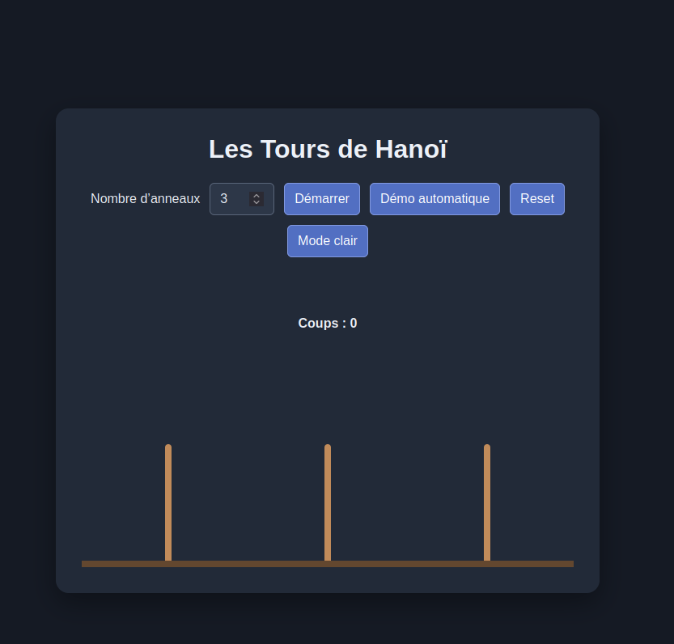
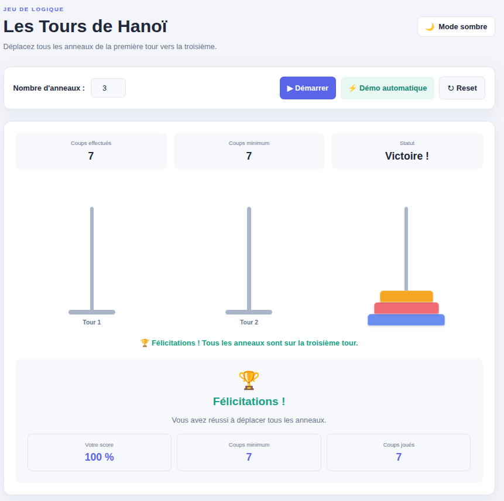
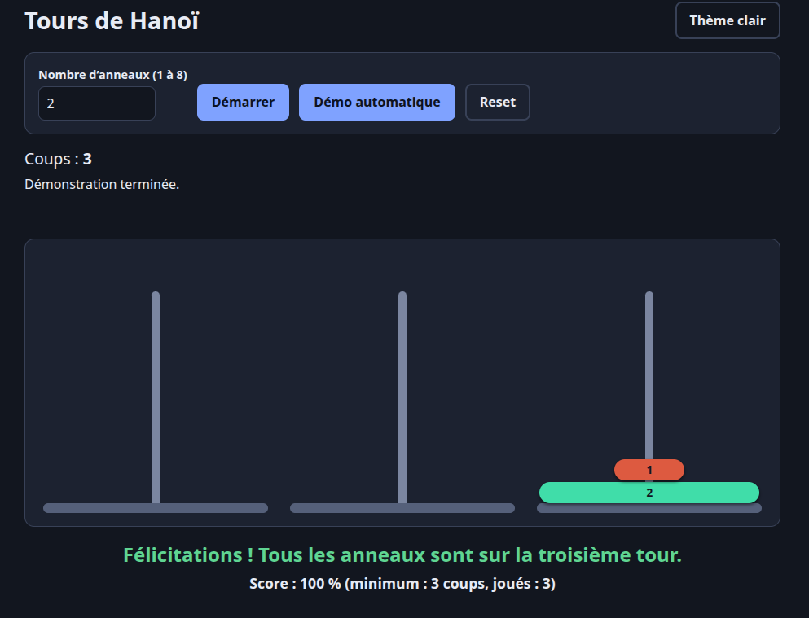
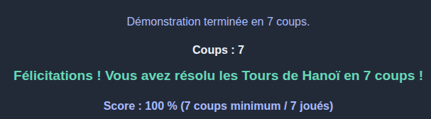
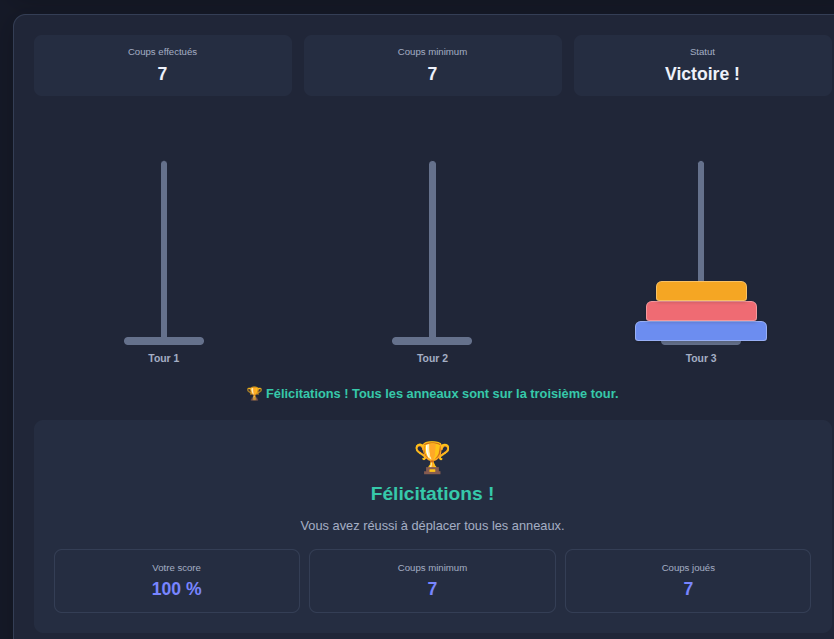

# Exercice 1 Page web minimale

# Prompt 1 (init)

- **Exercice :** Étape 1 — créer la page minimale du jeu des Tours de Hanoï en HTML, CSS et JavaScript natifs, avec une interface en français et sans logique de jeu.
- **LLM utilisé :** Copilot gpt-6-luna.
- **Texte du prompt :**

  > Dans le cardre de mon tp tu es un développeur web front-end et Je souhaite construire le jeu des Tours de Hanoï en HTML, CSS et JavaScript purs (aucune bibliothèque, aucun framework, pas de modules ES), en trois fichiers ouverts directement dans le navigateur : index.html, style.css et script.js. Interface en français. Étape 1 : crée la page minimale avec - une zone d’identifiant "plateau" contenant trois tours (éléments de classe "tour"), - un champ numérique d’identifiant "nb-anneaux" (min 1, max 8, valeur 3), - un bouton d’identifiant "btn-demarrer" libellé "Démarrer". Pas encore de logique de jeu. Donne le contenu complet des trois fichiers, sans explication. Enfin pour chaque prompt allimente le fichier prompt.md par son numéro (numéro du prompt), l’exercice, le LLM utilisé, le texte du prompt, et le résultat (fonctionne, bug observé, nombre de reformulations nécessaires).

- **Résultat :** Fonctionne — page statique créée ; aucune logique de jeu n’a été ajoutée.
- **Bug observé :** Aucun
- **Nombre de reformulations nécessaires :** 0.

# A. Le LLM a-t-il respecté la séparation en trois fichiers, ou placé du CSS ou du JavaScript dans la page ? A-t-il ajouté des éléments non demandés ? Corriger par un second prompt si nécessaire.
- Le LLM à bien respecté la séparation en 3 fichier, il n'a pas rajouté d'élément non demandés suplémentaire. Cependant j'ai la possibilité de saisir manuellement un chiffre supérieur à 8 ou inférieur à 1.

# B. Comparer les identifiants et classes générés à ceux demandés : pourquoi est-il utile de les imposer dès le premier prompt ?
- Car le LLM va définir les identifiant à sa manière et ça pourais ne pas répondre aux besoins de l'entreprise au niveau des règles imposé sur le nommage qui peuve exister en entreprise. De plus le nommage permet pour nous utilisateur du LLM de spécifier les endroits des erreurs plus facilement si on a connaissance de l'endroit où l'erreur à eu lieux.

# Exercice 2 Génération dynamique des anneaux

## Prompt 2

- **Exercice :** Étape 2 — démarrer ou réinitialiser le jeu avec le nombre d’anneaux choisi, en stockant les piles dans un état JavaScript et en reconstruisant le rendu depuis cet état.
- **LLM utilisé :** Copilot gpt-6-luna .
- **Texte du prompt :**

  > Toujours dans le cadre précédement définit je souhaite passer à la deuxième étapes de mon projet. J'aimerais que lorsque tu clique sur le btn Démarrer tu génère sur la tour 1 le nombre d'anneaux saisi dans l'input nb-anneaux. Visuellement les anneaux doivent être de largeur décroissante en partant de la base de la tour. Lorsque le bouton Démarrer subit un nouveaux clique le jeux doit être remis à l'état initial. Concernant l’état du jeu, l'état est une structure JavaScript (trois piles, par exemple un tableau de trois tableaux de tailles d’anneaux) et une fonction rendre() qui reconstruit l’affichage à partir de cet état. Enfin tu ne doit pas définir les valeur de la taillle des anneaux en dure dans l'html et prendre en compte que le DOM de la page n'est pas toujours fiable.

- **Résultat :** Fonctionne — le clic génère les anneaux sur la première tour depuis l’état JavaScript et un nouveau clic réinitialise les trois piles selon la valeur saisie.
- **Bug observé :** Aucun constaté lors de la vérification statique ; le rendu recrée les tours à partir de l’état et répare un plateau absent ou incorrect.
- **Nombre de reformulations nécessaires :** 0.

## A. Où le LLM a-t-il rangé l’état du jeu ? Si c’est dans le DOM (classes, attributs, ordre des éléments), demander la réécriture, et expliquer pourquoi cela compte pour les exercices suivants.
- L’état du jeu est rangé en JavaScript dans la variable `etat`, dans un tableau de trois piles. Chaque pile contient les tailles des anneaux qu’elle porte. Le DOM ne sert qu’à afficher cet état : la fonction `rendre()` recrée les tours et les anneaux à partir de `etat`. L’état n’est donc pas stocké dans les classes, les attributs ou l’ordre des éléments HTML, et aucune réécriture n’est nécessaire.
- Cette séparation est importante pour les exercices suivants : les déplacements et la vérification des règles pourront modifier et consulter une source de vérité fiable, indépendamment des changements ou erreurs du DOM. L’affichage pourra ensuite être reconstruit à tout moment à partir de l’état.

## B. Que se passe-t-il pour une valeur hors bornes (0, 12, vide) ? Faire corriger.
- Le LLM avait déjà pris en compte cette possibilité et à définit dans l'html correspondant à l'input des limit min max, donc si la valeur est hors bornes un message html par défaut est renvoyé. 

# Exercice 3 Déplacement des anneaux

## Prompt 3

- **Exercice :** Implémenter la sélection et le déplacement des anneaux, avec validation des règles de déplacement et retour visuel des coups refusés.
- **LLM utilisé :** Copilot gpt-6-luna.
- **Texte du prompt :**

  > Toujours dans le même cardre tu doit pour cette 3ème partie implémenter le déplacement des anneaux. Lorsque je sélectionne un anneux avec le clic de ma souris l'anneaux au sommets de la tours doit êtres déplacé aux second clique qui définit la tour d'arrivé la taille de l'anneaux sélectionné ne doit pas être modifier lors de sont déplacement d'une tour à l'autre. Les contraintes sont les suivantes: seul l’anneau du sommet d’une tour est sélectionnable, et il est mis en évidence ;le dépôt d'un anneau sur un anneau plus petit est refusé, avec un retour visuel, sans modifier l’état ; le dépôt d'un anneau sur une tour vide est accepté ; un clic sur la tour d’origine annule la sélection ;. les contraintes énoncé doivent êtres codé dans une fonction deplacementValide(de, vers) qui ne touche pas au DOM

- **Résultat :** Fonctionne — les piles restent la source de vérité, les déplacements valides modifient l’état, les coups interdits sont signalés sans changer les piles, et un clic sur la tour de départ annule la sélection.
- **Bug observé :** Aucun constaté pendant les tests navigateur.
- **Nombre de reformulations nécessaires :** 0.

## A. Tester deplacementValide directement dans la console sur des piles fabriquées à la main (tour vide, sommet plus petit, sommet plus grand). Pourquoi demander une fonction séparée plutôt qu’un test enfoui dans le gestionnaire de clic ?

- La fonction lit les piles `etat`, mais ne modifie ni l’état ni le DOM. Dans la console du navigateur, on peut tester les exemples suivantes et appeler directement la fonction :
  - `etat = [[3, 2], [], []]; deplacementValide(0, 1)` renvoie `true` : le sommet de la tour 1 peut être déplacé vers une tour vide.
  - `etat = [[3, 2], [1], []]; deplacementValide(0, 1)` renvoie `false` : l’anneau 2 ne peut pas être posé sur l’anneau 1, plus petit.
  - `etat = [[3, 1], [2], []]; deplacementValide(0, 1)` renvoie `true` : l’anneau 1 peut être posé sur l’anneau 2, plus grand.
- Séparer cette fonction de la fonction du gestionnaire de clic permet de tester les règles indépendamment de l’interface et du DOM, et de réutiliser la même règle pour chaque déplacement. Le gestionnaire de clic s’occupe des interactions et de l’affichage ; la fonction dédiée décide seulement si le déplacement est autorisé. Cela rend le code plus simple à vérifier et permet d'ajouter facilement des règles ou de supprimer des règles.

## B. Relever un cas que le LLM n’avait pas prévu (clic sur un anneau qui n’est pas au sommet, double clic, clic pendant qu’aucune partie n’est lancée) et le lui faire traiter.

Le LLM a déjà pris en compte ces cas dans mon prompt. Je n'ai pas trouvé de problème que le LLM n'ai pas traité 

# Exercice 4 Améliorations visuelles

## Prompt 4 — surbrillance et transitions
  **Note** Le LLM avait déjà traité sans que je lui demande cette partie je vais donc faire un prompt afin qu'il puisse améliorer l'existant. 
- **Exercice :** Améliorer la mise en évidence de l’anneau sélectionné, l’élever avec une transition et animer son déplacement vers une autre tour ainsi que l’annulation de la sélection.
- **LLM utilisé :** Copilot gpt-6-luna.
- **Texte du prompt :**

  > Toujours dans le même cardre tu doit pour cette 4ème partie peut tu rendre plus visuelle l'interface, j'aimerais que lorsque je sélectionne un anneaux celui-ci ne soit plus encadré en noir mais qu'il subit une surbrillance dans une couleur agrable est qu'il y ait une transition lorsqu'il est déplacé d'une tour à l'autre. Par ailleurs lors de la sélection d'un anneaux j'aimerais en plus de la surbrillance que celui-ci soit mis en hauteur par rapport à la tour afin de l'identifier clairement toujours à l'aide d'une transition et si je souhaite annuler sa sélection une transition le repose sur la tour.

- **Résultat :** Fonctionne — l’anneau sélectionné est surélevé et éclairé par une surbrillance turquoise, l’annulation le repose avec transition, et son déplacement entre tours est animé sans modifier sa taille.
- **Bug observé :** Aucun constaté lors de la vérification dans le navigateur.
- **Nombre de reformulations nécessaires :** 0. Je n'ai pas trouvé de problème que le LLM n'ai pas traité

## A. Le LLM a-t-il modifié script.js alors que seul le style était demandé ? Quelle contrainte ajouter au prompt pour l’en empêcher ?
Oui, la contrainte à ajouter serait de ce style : Prompt précédent + en ne modifiant pas le contenu du fichier script.js

## B. Demander deux propositions de style différentes dans un même prompt, puis en retenir une : en quoi le format de réponse demandé change-t-il la qualité du résultat ?

- **Promptdemandé :**

  > À partir de l’interface actuelle du jeu des Tours de Hanoï, propose exactement deux directions graphiques différentes, sans modifier les fichiers pour le moment. Pour chaque proposition, présente séparément : son nom, sa palette de couleurs, le style des tours et des anneaux, et l’ambiance générale. Conserve une bonne lisibilité, un contraste accessible et les animations existantes. Termine par une recommandation argumentée. Après mon choix, applique uniquement la proposition retenue dans `style.css`, sans changer le fonctionnement du jeu ni modifier `index.html` ou `script.js`.

- **Effet du format de réponse :** Demander exactement deux propositions présentées selon les mêmes critères rend leur comparaison plus facile et évite une liste vague ou des variantes presque identiques. Demander de ne pas modifier les fichiers avant le choix évite que plusieurs styles soient mélangés ou appliqués sans décision. Enfin, préciser les fichiers autorisés limite les changements au style et protège la logique du jeu.

# Exercice 5 Démo automatique

## Prompt 5 démo automatique

- **Exercice :** Ajouter une démonstration automatique récursive des Tours de Hanoï, avec lecture animée des coups, départ depuis une partie neuve et interaction verrouillée pendant la résolution.
- **LLM utilisé :** Copilot (modèle précis non exposé dans cette session).
- **Texte du prompt :**

  > Toujours dans le même cardre tu doit pour cette 5ème étape rajouter un Bouton "Démo automatique" qui résout le jeu grâce à un algorithme récursif à l'aide de 2 fonction la première : resoudre(n, de, vers, via) qui renvoie la liste des coups (des couples [de, vers]) sans rien afficher la seconde fonction : une fonction qui rejoue cette liste coup par coup avec un délai (setTimeout, ou async/await avec une fonction d’attente) Les contraintes à respecté sont les suivante: - la démo doit repartir d'une partie neuve et se termine avec tous les anneaux sur la troisième tours - lors de la résolution pour 3 anneaux tu doit avoir besoins de 7 coups pour résoudre le partie et pour 5 anneaux 31 coups - pendant la démo l'utilisateur ne peux pas intéragir avec les élément présent sur la page - la fonction resoudre(3, 0, 2, 1).length doit retourné 7

- **Résultat :** Fonctionne — `resoudre(3, 0, 2, 1).length` renvoie 7 et `resoudre(5, 0, 2, 1).length` renvoie 31. Les tests navigateur confirment que les deux démonstrations repartent d’une partie neuve, terminent avec tous les anneaux sur la troisième tour, et verrouillent les commandes et le plateau pendant l’exécution.
- **Bug observé :** Aucun 
- **Nombre de reformulations nécessaires :** 0.

## A. Envoyer d’abord le prompt sans donner l’algorithme : le LLM le connaît-il ? Est-il correct ?

- Oui, le LLM connaît l’algorithme récursif classique des Tours de Hanoï. La fonction `resoudre(n, de, vers, via)` en applique la logique en renvoyant une liste plutôt qu’en exécutant directement les déplacements : elle calcule les coups pour déplacer `n - 1` anneaux vers la tour intermédiaire, ajoute le coup `[de, vers]`, puis calcule les coups pour déplacer les `n - 1` anneaux vers la destination. Pour `n = 0`, elle renvoie une liste vide, ce qui correspond à « ne rien faire ».
- L’algorithme est correct : `resoudre(3, 0, 2, 1).length` vaut `7` et `resoudre(5, 0, 2, 1).length` vaut `31`, conformément au nombre minimal de coups `2^n - 1`. Il respecte donc aussi la séquence récursive attendue.

## B. Pourquoi séparer le calcul de la liste des coups de leur exécution animée ? Que se passe-t-il si l’utilisateur clique sur « Démarrer » pendant la démo, et comment le LLM a-t-il traité ce cas ?

- Séparer `resoudre()` de `rejouerCoups()` permet de vérifier les règles et le nombre de coups sans dépendre du DOM, des délais ou des animations. La fonction rejouer se concentre sur l’exécution : elle applique chaque coup à l’état, met l’affichage à jour et attend la fin de l’animation avant le suivant.
- Pour bloquer les commandes, le gestionnaire du bouton de démo met d’abord `demoEnCours` à `true`, puis définit les propriétés `disabled` du champ `nb-anneaux`, du bouton « Démarrer » et du bouton « Démo automatique » à `true`. Il définit aussi `inert` sur le plateau : ses éléments ne peuvent alors plus recevoir de clic ni de focus. En complément, le gestionnaire de clics du plateau vérifie `demoEnCours` et ignore toute interaction pendant la résolution. Le bloc `finally` remet `disabled` et `inert` à `false` et repasse `demoEnCours` à `false`, même si une erreur survient pendant la démo afin d'éviter toute intéraction utilisateur sur le plateaux.

# Exercice 6 Extensions obligatoires

## Objectif 1 — Compteur de coups

- **Exercice :** Ajouter un compteur qui s’incrémente après chaque coup valide, en mode manuel comme pendant la démo automatique.
- **LLM utilisé :** Copilot gpt-6-luna.
- **Texte du prompt :**

  > Toujours dans le même cardre tu doit pour cette 6ème étape qui contiendra plusieurs objectif rajouter différents élément pour compléter le jeux. Pour ce première objectif j'aimerais que tu rajoute un compteur de coups incrémenté en mode manuel comme en démo

- **Résultat :** Fonctionne — le compteur s’incrémente à chaque déplacement valide en mode manuel et à chaque coup de la démo. Il est remis à zéro au démarrage d’une nouvelle partie ou d’une nouvelle démo.
- **Bug observé :** Aucun constaté pendant les tests.
- **Nombre de reformulations nécessaires :** 0.

## Objectif 2 — Détection de victoire

- **Exercice :** Détecter la victoire quand tous les anneaux sont empilés dans le bon ordre et afficher un message de félicitations.
- **LLM utilisé :** Copilot gpt-6-luna.
- **Texte du prompt :**

  > Pour se second objectif de l'étape 6 j'aimerais que tu rajoute un moyens de détecter la victoire lorsque l'utilisateur à empilé tous les anneaux dans le bonne ordre (du plus grand au plus petit) permettant ainsi d'afficher un message de félicitation à l'utilisateur lorsqu'il à réussi à remplir la conditon de victoire

- **Résultat :** Fonctionne — après une victoire, un message de félicitations s’affiche avec le nombre de coups. La vérification a réussi en mode manuel comme en démo ; le LLM à pris l'initiative de faire en sorte que le message disparaît si les anneaux sont déplacés hors de la configuration gagnante.
- **Bug observé :** Aucun constaté pendant les tests navigateur.
- **Nombre de reformulations nécessaires :** 0.

## Objectif 3 — Score basé sur le nombre minimal de coups

- **Exercice :** Calculer un score à partir du nombre minimal de coups requis pour le nombre d’anneaux choisi et du nombre de coups joués.
- **LLM utilisé :** Copilot gpt-6-luna.
- **Texte du prompt :**

  > pour ce 3ème objectif de l'étape 6 j'aimerais que tu réalise un système de score basé sur le nombre minimal de coup nécessaire normalement pour réussir la tour hanoi pour n anneaux le score doit être calculé en faisant le rapport entre le minimum et le nombre de coups joués. Le minimum doit suivre la formule suivante 2n − 1 utilisé dans la fonction resoudre(n, de, vers, via) afin de récupérer le nombre de coup minimal tu peux utiliser resoudre(n, de, vers, via).length

- **Résultat :** Fonctionne — le score affiché à la victoire est le pourcentage du rapport entre le minimum (`resoudre(n, 0, 2, 1).length`) et les coups joués. Avec 2 anneaux résolus en 5 coups, le score est de 60 % (3 minimum / 5 joués) ; la démo optimale à 3 anneaux donne 100 % (7 / 7).
- **Bug observé :** Aucun constaté pendant les tests navigateur. Le compteur, le message de victoire et le score sont effacés au redémarrage.
- **Nombre de reformulations nécessaires :** 0.

## Objectif 4 — Réinitialisation de la partie

- **Exercice :** Ajouter un bouton « Reset » qui vide le plateau et remet à zéro le compteur, le score, la sélection et les messages, y compris pendant une démonstration automatique.
- **LLM utilisé :** Copilot gpt-6-luna.
- **Texte du prompt :**

  > pour ce 4ème objectif de l'étape 6 j'aimerais que tu rajoute un bouton "Reset" qui remet le compteur, le score, la sélection et l'affichage à zéro, y compris pendant une démo ;

- **Résultat :** Fonctionne — Reset vide le plateau, remet le compteur à 0, efface le score, le message de victoire, le statut de démo et la sélection. Le bouton reste actif pendant la démo ; son activation interrompt l’animation et empêche les coups restants de s’exécuter.
- **Bug observé :** Aucun constaté pendant les tests navigateur. Une nouvelle démo fonctionne correctement après une réinitialisation en cours d’exécution.
- **Nombre de reformulations nécessaires :** 0.

## Objectif 5 — Trajectoire de déplacement des anneaux

- **Exercice :** Repenser les animations pour que l’anneau se soulève au-dessus des tours, glisse horizontalement, puis redescende à la base de la tour d’arrivée.
- **LLM utilisé :** Copilot gpt-6-luna.
- **Texte du prompt :**

  > pour ce 5ème objectif j'aimerais que tu repense les animations existante afin que l’anneau se soulève, se glisse depuis le haut de la tour et redescend jusqu'a sa base , plutôt que de ce déplacé directement à la base de la tour

- **Résultat :** Fonctionne — l’animation utilise une première étape afin soulevé l'anneaux au dessus de sa tour actuelle, un trajet horizontal au-dessus des tours, puis une descente jusqu’à la tour d’arrivée. La même trajectoire est utilisée en mode manuel et en démo.
- **Bug observé :** Aucun constaté pendant les tests navigateur. Reset interrompt correctement la démo même au milieu de l’animation.
- **Nombre de reformulations nécessaires :** 0.

## Objectif 6 — Bascule du thème clair/sombre

- **Exercice :** Ajouter un bouton qui bascule toute la page entre les thèmes clair et sombre, et mémoriser le choix pour qu’il survive à Reset et au rechargement.
- **LLM utilisé :** Copilot gpt-6-luna.
- **Texte du prompt :**

  > pour ce 6ème objectif et le dernier de l'étape 6 j'aimerais que tu rajoute un bouton pour basculer d'un mode sombre ou clair, ce choix doit être conservé en mémoire et appliquer sur toute la page afin d'éviter que pendant le "Reset" le mode revienne à l'état d'origine

- **Résultat :** Fonctionne — le bouton bascule toute la page entre clair et sombre. Le choix est conservé dans `localStorage`, reste appliqué après Reset et est restauré après rechargement de la page.
- **Bug observé :** Aucun constaté pendant les tests navigateur.
- **Nombre de reformulations nécessaires :** 0.

## Questions

### A. Quelle technique le LLM a-t-il choisie pour l’animation (transitions CSS, transform, API element.animate()) ? Lui demander de justifier son choix et de proposer l’alternative.

- Pour le déplacement d’une tour à l’autre, le code utilise l’API Web Animations `element.animate()` avec plusieurs images clés et la propriété CSS `transform: translate(...)` : l’anneau se soulève, glisse au-dessus des tours, puis redescend. Les transitions CSS restent utilisées pour la surbrillance et l’élévation lors de la sélection.

- **Prompt demandé  :** 

  > Peut tu expliquer ton choix technique lors de la réalisation des animations du 5ème objectif de l'étape 6, pourquoi avoir utilisé l'api élément animate et pasun autre technologie et si tu devais utilisé une autre technologie propose moi une alternative et jusitifie celle-ci  

- **Réponse :** J’ai choisi l’API Web Animations `element.animate()` parce que le déplacement comporte plusieurs étapes avec des positions calculées au moment du coup : l’anneau monte au-dessus des tours, glisse horizontalement, puis redescend sur la tour d’arrivée. L’API permet de définir ces étapes dans une seule animation avec des images clés (`keyframes`) et `transform`, sans ajouter de bibliothèque. Elle fournit aussi une animation contrôlable dont on peut attendre la fin pendant la démo ou qu’on peut annuler avec Reset. Les transitions CSS conviennent mieux aux changements simples d’état, comme la surbrillance et l’élévation d’un anneau sélectionné, mais elles sont moins pratiques pour synchroniser une trajectoire en plusieurs phases.
- **Alternative :** On pourrait définir la trajectoire avec `@keyframes` en CSS et transmettre les distances calculées par JavaScript sous forme de variables CSS. Cela séparerait davantage les styles de la logique et permettrait de réutiliser les règles d’animation. Pour ce jeu, je garderais toutefois `element.animate()` : la trajectoire dépend des positions réelles des tours et la démo doit attendre ou interrompre précisément chaque animation. Avec des animations CSS, il faudrait gérer les événements de fin et d’annulation séparément.

### B. Quelle fonctionnalité a demandé le plus de reformulations ? Formuler en une phrase ce qui manquait au premier prompt.

- Le LLM n'a pas eu besoin de reformulation pour que le fonctionnalité soit toutes opérationelles. 

### C. Comment le LLM écrit-il 2n − 1 en JavaScript ? Vérifier dans la console pour n = 8.

- Il l'écrit `2 ** n - 1`. Pour `n = 8` il retourne 255`. 

Capture du jeux à cette état 

# Exercice 7 Recommencer à zéro : un prompt unique

## Tableau comparatif des LLM

| Critère | Claude (version gratuite) | ChatGPT (version gratuite) |
|---|---|---|
| Fonctionnalités correctes au premier prompt | Toutes les fonctionnalités demandées ont été réalisées correctement dès le premier prompt. | Toutes les fonctionnalités ont été réalisées, sauf les animations des anneaux, qui étaient absentes au premier résultat. Elles ont été ajoutées après une reformulation. |
| Nombre de reformulations | 0 | 1 |
| Taille du code | `script.js` : 586 lignes ; `index.html` : 55 lignes ; `style.css` : 321 lignes. **Total : 962 lignes.** | `script.js` : 1 409 lignes ; `index.html` : 143 lignes ; `style.css` : 727 lignes. **Total : 2 279 lignes.** Environ la moitié de `script.js` concerne les animations des anneaux. |
| Respect des contraintes | Toutes les contraintes ont été respectées dès le premier prompt. | Les contraintes ont été respectées dès le premier prompt sans compté la reformulation portant sur les animations. |
| Lisibilité et organisation | Les fonctionnalités de JavaScript sont séparées et expliquées par des commentaires. Les règles CSS ne sont toutefois pas séparées par des commentaires, ce qui rend certaines parties du fichier `style.css` moins faciles à retrouver. | Les fonctionnalités et les fonctions JavaScript sont commentées. Les différentes parties du fichier `style.css` sont également séparées par des commentaires, ce qui facilite leur repérage. |
| Interface utilisateur | L’interface est moins agréable visuellement que celle de ChatGPT, selon mon appréciation. | L’interface me paraît plus agréable. Cette différence se reflète aussi dans la taille plus importante de `index.html` et de `style.css`. |

Résultat de chatgpt version gratuite 

Résultat de claude version gratuite 

## A. Quelles parties du prompt ont eu le plus d’effet ? Retirer une contrainte (par exemple l’architecture imposée) et relancer : que change-t-il ?

La partie du prompt qui à eu le plus d'effet ce retrouve dans l'architecture à respecter, chaque LLM a bien respecté l'architecture  ainsi que le nom des fonction et des classe dans le code. Lorsque j'ai retirer l'architecture chatgpt m'a fait le même résultat mais a rassemblé dans 1 seul fichier html toutes les fonctionnalité tandit que claude à m'a crée plusieurs fichier différents pour séparer les différents morceaux de code .js Les principaux changement se font côté IHM, les choix de couleur et l'affichage des informations sont différents.

## B. Le code obtenu en un prompt est-il meilleur ou moins bon que celui construit en six exercices ? Sur quels critères ?

Le code généré à partir d’un seul prompt me semble meilleur sur le plan de la présentation. En construisant le jeu en six étapes, les éléments d’interface ont été ajoutés progressivement, sans réorganisation globale. Comme le montre l’image ci-dessous, les différents textes apparaissent les uns à la suite des autres, dans l’ordre où les fonctionnalités ont été ajoutées : 

Avec un prompt unique, le LLM peut prendre en compte l’ensemble des fonctionnalités et des contraintes dès le départ. Le résultat offre ici une présentation plus cohérente et agréable à utiliser, comme le montre cette image : 

Cette comparaison porte principalement sur la qualité visuelle et l’organisation de l’interface. Cependant du points de vu du code que ce soit pour chatgpt ou claude les 2 LLM on produit beaucoup plus de code dans script.js, on resent donc que avec les 6 exercice le code est plus court et va directement aux besoins essentielle alors que en 1 prompt les LLM rajoute du code pas explicitement demandé comme la qualité visuelle différente entre les 2 LLM.

# Exercice 8 Documentation automatique (optionnel)

## Prompt 8 — Documentation JSDoc

- **Exercice :** Ajouter une en-tête JSDoc à chaque fonction de `script.js`, avec une description, les paramètres typés et la valeur de retour.
- **LLM utilisé :** Copilot gpt-6-luna.
- **Texte du prompt :**

  > enfin pour cette 8ème étape dans le context d'un développeur back-end rajoute une entête pour chaque fonction dans script.js les commentaire devront utilisé le format JSDoc et pour chaque fonction le format attendu doit ressemblé à celui fournis dans cette exemple /**
  > * Calcule la liste des coups qui déplace n anneaux d’une tour à une autre.
  > * @param {number} n Nombre d’anneaux à déplacer.
  > * @param {number} de Tour de départ (0, 1 ou 2).
  > * @param {number} vers Tour d’arrivée.
  > * @param {number} via Tour intermédiaire.
  > * @returns {number[][]} Liste de couples [de, vers], dans l’ordre d’exécution.
  > */
  > function resoudre(n, de, vers, via)

- **Résultat :** Après reformulation, les fonctions principales de `script.js` ont une en-tête JSDoc avec description, paramètres et valeur de retour.
- **Bug observé :** Aucun constaté lors de la vérification syntaxique.
- **Nombre de reformulations nécessaires :** 1.
- **Texte de la première reformulation :**

  > ne produit pas d'entête pour les fontions utilisé au sein d'une fonction

## A. Relire chaque docstring en regard du code : en trouver au moins une inexacte, vague ou incomplète (paramètre oublié, valeur de retour fausse, effet de bord non mentionné) et la corriger, à la main ou par un prompt ciblé.

Réponse générer par un prompt au LLM

En relisant les docstrings de `script.js`, j’ai repéré celle de `attendreDelai(ms, signal)`. Elle indiquait seulement que la promesse était résolue à la fin du délai, sans préciser qu’elle pouvait aussi être rejetée lorsque le signal d’annulation est déclenché. La description était donc incomplète, car l’annulation fait partie du comportement prévu par cette fonction.

J’ai corrigé la docstring pour indiquer les deux issues : la promesse est résolue lorsque le délai de `ms` millisecondes expire, ou rejetée avec une erreur `AbortError` si `signal` est annulé avant. J’ai également précisé les docstrings des autres fonctions retournant une promesse : `attendreAnimation` mentionne le rejet en cas d’annulation de l’animation, et `rejouerCoups` distingue la fin normale du rejeu, l’arrêt entre deux coups et les erreurs pendant une attente ou un déplacement illégal.

La syntaxe de `script.js` a été vérifiée avec `node --check` après ces corrections : aucune erreur n’a été signalée.

## B. Demander ensuite au LLM une page tests.html qui charge script.js puis un fichier tests.js vérifiant dans la console resoudre (nombre de coups, validité de chaque coup, position finale) et deplacementValide. Un test échoue-t-il ? Qui a tort, le test ou le code ?

